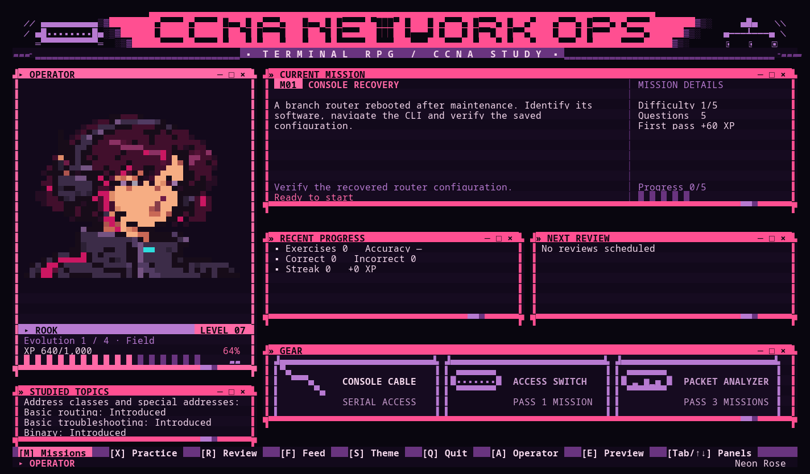

# CCNA Network Ops

CCNA Network Ops is a retro cyberpunk terminal RPG for CCNA certification practice. The **1.0 release candidate** includes six missions, adaptive practice, scheduled review, and 261 bundled questions across the 26 study areas and a VLAN scenario.



[Mission briefing](design/screenshots/rc-mission-briefing.png) · [Mission quiz](design/screenshots/rc-mission-quiz.png) · [Mission results](design/screenshots/rc-mission-summary.png)

The dashboard tracks the operator level, XP, mission progress, studied topics, scheduled reviews, and cosmetic gear. It has five saved themes, keyboard navigation, and Sixel portraits with a true-color Unicode fallback. While the dashboard is idle, a light runs through the network icons and the strip below the title. The focused panel’s corners and the footer arrow pulse gently. When the app opens, the visible dashboard panels type in their text in parallel, one character at a time per panel. Any key completes the reveal immediately.

## Requirements

- Fedora Linux with Python 3.12 or newer.
- An interactive UTF-8 terminal with true-color support. Konsole is the tested graphical terminal.
- A terminal size of at least 50 × 18. Use 110 × 35 or larger for the full dashboard.

The app uses Python’s standard library. Running it requires no pip packages.

## Install and run on Fedora

If Python is missing, install Fedora’s `python3` package:

```sh
sudo dnf install python3
```

Download and extract the repository’s source archive, or clone it from GitHub. Open a terminal in the project directory and run:

```sh
python3 ops.py
```

The default launch probes the terminal for Sixel support and falls back to Unicode. To force the fallback:

```sh
python3 ops.py --avatar text
```

## Study modes

The default launch registers the bundled packs. Existing imports and progress carry forward. To launch with only the sources already in your study database, pass `--no-bundled`.

- **Mission (M).** Choose an operation with the arrow keys and press **Enter** for its briefing. Press **Enter** to start or resume. Each operation uses a fixed set of five or six certification-style questions and requires at least 80% accuracy. Press **N** after the final answer to see accuracy, XP and missed topics. Press **H** in the mission list to reopen the selected operation’s latest run. One mission can be in progress at a time, and finished missions can be replayed. The first pass awards the briefing’s bonus.
- **Practice (X).** Start or resume a randomized round of up to 100 unique questions from bundled and imported packs. If fewer than 100 are available, the round uses the full pool in random order. The CCNA exam’s question count varies, so 100 is the practice target. Open the results after the last answer to see overall and per-topic accuracy. Press **Enter** to start a new draw.
- **Review (R).** Work through scheduled questions due today or earlier. Review shares the same question history as Practice and Missions and saves its own current question.

| Mission | Focus | Questions | First-pass bonus |
| --- | --- | ---: | ---: |
| Console Recovery | Platforms, CLI, configuration and output filters | 5 | 60 XP |
| Session Trace | OSI, transport, ports, IPv4 and traffic types | 5 | 80 XP |
| Subnet Ops | IPv4 masks, binary, CIDR, VLSM and special prefixes | 6 | 100 XP |
| The VLAN Breach | Inter-VLAN routing, Ethernet, switching and ARP | 5 | 80 XP |
| Ethernet Triage | Cabling, duplex, PoE, device roles and IOS interfaces | 5 | 80 XP |
| Static Route Recovery | Static routing, NAT and reachability diagnostics | 5 | 100 XP |

Select alternatives with **A–D** and submit with **Enter**. After submission, the bundled questions explain why each alternative is correct or incorrect and mark the ones you selected. Feedback also shows XP earned and the next review date. Use **↑/↓** or **PgUp/PgDn** to scroll through longer feedback. Use **N** to advance. Completed missions unlock cosmetic gear at one and three distinct passes. The [question bank report](content/generated/ccna-v1.1-exam-style-v2/QUESTION_BANK_REPORT.md) lists the bundled exam-style packs and their coverage.

### Feed

To import an additional question pack from the terminal, run `python3 ops.py --feed path/to/pack.json`. Press **F** for the local library and **T** to switch to its inbox. Copy a `.json`, `.md`, or `.txt` file into `${XDG_DATA_HOME:-$HOME/.local/share}/ccna-network-ops/inbox/`. Use the arrow keys and **Enter** to import it. Switch back to the library to open an imported source or read its note. Longer entries and questions support **Page Up** and **Page Down**.

Markdown and text notes need a first line such as `Topic: Ethernet` and may have a second line such as `Subtopic: MAC learning`. You can also pass the topic explicitly:

```sh
python3 ops.py --feed my-notes.md --topic "Ethernet" --subtopic "MAC learning"
python3 ops.py --activate "Routing"
```

Notes and explicit activation introduce topics without creating exercises. Only validated packs supply quiz questions. Feed imports leave the current question and its pending selections intact.

Use the [question-pack schema](question-pack.schema.json) and a starter pack as a template. Use English text, difficulty 1–5, two to four distinct options labeled consecutively from A, an explanation, and globally unique question IDs. Use one correct key for `single_choice` and two or more for `multiple_choice`. Use `option_explanations` to provide a separate reason for each key in `options`. Packs with only the general `explanation` still display it after submission. An optional `snippet` field displays IOS output or configuration as text. The importer checks the schema rules, answer-key membership, identifiers, duplicate content keys and unsafe control characters. It checks structure and consistency. Pack authors review the technical correctness of their questions and explanations. A duplicate import is rejected with the existing history intact.

## Keyboard navigation

| Key | Action |
| --- | --- |
| Tab / ↓ | Focus the next panel |
| Shift+Tab / ↑ | Focus the previous panel |
| A | Switch the saved operator on the dashboard or compare operators in preview |
| E | Preview all four stages in order, then return to the equipped stage |
| Esc in preview | Return to the equipped portrait |
| M / X / R | Open Missions / Practice / Review |
| F | Open the local Feed |
| Enter on Mission | Open the mission list |
| H in mission list | Show the selected mission’s latest run |
| Enter on Progress, Review, or Topics | Open the full dashboard panel details |
| S | Open theme settings |
| 1–5 | Select a theme in settings |
| Esc | Go back |
| Q / Ctrl+C | Quit |

In the compact layout, panel focus also pages through the dashboard.

| Quiz key | Action |
| --- | --- |
| ↑ / ↓ | Move through alternatives |
| A–D | Pick a single answer or toggle a multiple-answer option |
| Space | Toggle the highlighted multiple-answer option |
| Enter | Submit the answer |
| N | Advance after feedback or view final mission results |
| Esc / Q | Return to the dashboard with the current question saved |
| Page Up / Page Down | Scroll long prompts, snippets, and feedback |

In Feed, **Q** or **Esc** backs out of the current view. **Ctrl+C** exits the application from any screen.

## Themes

1. Mint Circuit
2. Neon Rose (default)
3. Cyber Emerald
4. Amber CRT
5. Violet Protocol

The selected theme is saved under `${XDG_CONFIG_HOME:-$HOME/.config}/ccna-network-ops/theme`.

## Progress, adaptation, and reviews

- A topic becomes **Introduced** on import or explicit activation and **Practiced** after the first attempt. **Mastered** requires at least 80% topic accuracy and at least three distinct questions whose latest attempts were correct.
- The operator starts at level 7 with 640 XP toward the next 1,000-point threshold, as in the original dashboard. The first correct answer to a question awards `20 × difficulty` XP. Repeated correct answers still count toward accuracy and reviews. Both Rook and Relay have four portrait stages, unlocked at levels 7, 8, 9 and 10. The selected operator is saved and shares the same learning progress. Preview is temporary and can show locked stages. A missing or invalid stage sprite falls back to the same operator’s base portrait, then to their first available stage or an empty matte.
- The scheduler considers unseen questions and questions due today or earlier. It prioritizes due reviews, balances eligible categories against the long-run targets, then favors weaker topics and missed questions. It avoids immediately repeating a question when another eligible choice exists.
- Default weights are 35% networking theory, 20% IOS commands, and 15% each for IOS output, troubleshooting, and subnetting. Practice uses these weights when drawing questions without replacement. Review uses them when prioritizing due questions. To override the targets, put a JSON object with positive integer weights for all five category IDs in `${XDG_CONFIG_HOME:-$HOME/.config}/ccna-network-ops/category-weights.json`.
- Correct answers schedule reviews at 1, 3, 7, 14, then 30 days. Further correct answers stay at 30 days. An incorrect answer resets the sequence and schedules review in one day. Dates use UTC.
- Study data lives in `${XDG_DATA_HOME:-$HOME/.local/share}/ccna-network-ops/learning.sqlite3`. The database saves each mode’s active question, selections and exercise number, plus mission runs and completion bonuses. Submitting an answer records the attempt and updates its review date in one transaction. A final mission answer also records the result and any bonus in that transaction. The app upgrades existing study databases in place and keeps the saved theme in its configuration file.

## Scope and roadmap

Study is local and selection-based. IOS output and topologies are study examples. The project is independent of Cisco. The release defers typed command grading, live network labs, packet simulation, multiplayer, cloud services, external AI integration, and coverage of objectives beyond the supplied syllabus. The base portraits were generated with OpenAI image generation and prepared as indexed pixel art. Advanced stages add operator equipment to the indexed sprites.

## Verification

```sh
python3 -m unittest
python3 verify.py
python3 content/generated/ccna-v1.1-exam-style-v2/validate_bank.py
```

The Linux pseudoterminal suite checks 140×45, 110×35, 80×24 and 50×18 layouts, theme and portrait behavior, Feed, Practice, mission briefing and completion, resume across processes, and due Review. The engine tests check schema validation, scoring, review scheduling, database migration, and one-time mission rewards.

To try the release candidate with temporary progress and theme files, run from the project directory:

```sh
test_profile=$(mktemp -d)
XDG_DATA_HOME="$test_profile" XDG_CONFIG_HOME="$test_profile" python3 ops.py
```
