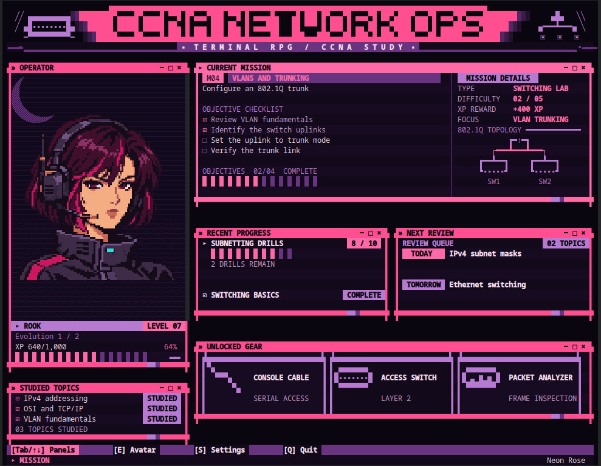

# CCNA Network Ops

CCNA Network Ops is a retro cyberpunk terminal RPG proof of concept for CCNA certification study. It shows how a network-operations dashboard could organize missions, progress, and reviews in a keyboard-driven Linux TUI.



*Neon Rose at 140 × 45 in Konsole with Sixel rendering.*

## Features

- A mission checklist and network topology, recent progress, a review queue, studied topics, and equipment cards.
- A sample operator profile with XP and two portrait stages.
- Five themes with live switching and a saved theme preference.
- Responsive panel layouts, with a paged view at narrow sizes.
- Sixel portraits on compatible terminals and a true-color Unicode fallback.

## Requirements

- Fedora Linux with Python 3.12 or newer.
- An interactive UTF-8 terminal with true-color support. Konsole is the tested graphical terminal.
- A terminal size of at least 50 × 18. Use 110 × 35 or larger for the full dashboard.

The app uses Python’s standard library. Running it requires no pip packages.

## Install and run on Fedora

If Python is missing, install Fedora’s `python3` package:

```sh
sudo dnf install python3
```

Download and extract the repository’s source archive, or clone it from GitHub. Open a terminal in the project directory and run:

```sh
python3 ops.py
```

The default launch probes the terminal for Sixel support and falls back to Unicode. To force the fallback:

```sh
python3 ops.py --avatar text
```

## Keyboard navigation

| Key | Action |
| --- | --- |
| Tab / ↓ | Focus the next panel |
| Shift+Tab / ↑ | Focus the previous panel |
| E | Switch the portrait stage |
| S | Open theme settings |
| 1–5 | Select a theme in settings |
| Esc | Return from settings |
| Q / Ctrl+C | Quit |

In the compact layout, panel focus also pages through the dashboard.

## Themes

1. Mint Circuit
2. Neon Rose (default)
3. Cyber Emerald
4. Amber CRT
5. Violet Protocol

The selected theme is saved under `${XDG_CONFIG_HOME:-$HOME/.config}/ccna-network-ops/theme`.

## Proof-of-concept scope

Missions, XP, gear, and review entries use sample data. The portrait stages are manually selectable. The theme is the only persistent application setting. The project is independent of Cisco and is an interface prototype for study workflows.

The Rook portraits were generated for this project with OpenAI image generation and prepared as indexed pixel art.

## Development roadmap

- Add interactive mission and practice flows around the dashboard.
- Track study results and use them to schedule reviews.
- Test rendering and input across more Linux terminal emulators.

Run the local smoke test before changing layout, navigation, theme persistence, or avatar rendering:

```sh
python3 verify.py
```
